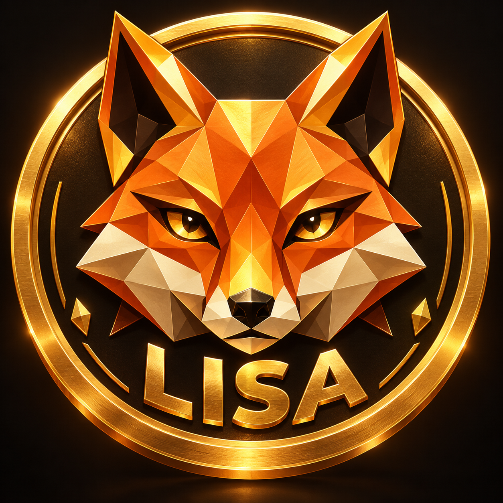

  

<h1 align="center">LISA 🦊</h1>

<strong>An independent fox-inspired meme coin initiative on Polygon</strong>

<strong>CRYPTO IMPERIAL Ecosystem · Enterprise-style engineering documentation</strong>

<em>Distinctive identity. Verifiable facts. Responsible development.</em>

  <a href="#token-identity">Token identity</a> ·
  <a href="#what-exists">Current status</a> ·
  <a href="#architecture-and-trust">Architecture</a> ·
  <a href="#roadmap">Roadmap</a> ·
  <a href="#security-and-transparency">Security</a>

---

## About LISA

**LISA** is a fox-themed meme coin project presented within the **CRYPTO IMPERIAL Ecosystem**. The angular, low-poly orange fox is the project's visual identity. Its design is original project artwork, not a claim of association with MetaMask or any wallet provider.

This repository is the **public presentation, identity, governance, and documentation entry point**. It does not claim that a production agent-payment network, token market, exchange listing, utility system, or revenue-producing business has been delivered.

**Founder / architectural authority:** Alexander Romaskevich — **RomaskevicH**  
**Project classification:** meme coin / digital-asset initiative  
**Network identified by project owner:** Polygon PoS, chain ID 137  
**Public contract reference supplied by the owner:**  
**0xb570c3686776a052beB44Be89eE16d4d2fc29FAe**

## Token identity

| Property | Current evidence boundary |
| --- | --- |
| Project name / ticker | LISA |
| Network | Polygon PoS (owner-supplied identity; independently verify) |
| Chain ID | 137 |
| Contract | [0xb570c3686776a052beB44Be89eE16d4d2fc29FAe](https://polygonscan.com/token/0xb570c3686776a052beB44Be89eE16d4d2fc29FAe) |
| Source verification | [Inspect on Sourcify](https://repo.sourcify.dev/137/0xb570c3686776a052beB44Be89eE16d4d2fc29FAe); exact-match status not asserted here |
| Current supply, decimals and controls | **Not independently attested in this repository** |
| Liquidity, trading volume, exchange listing | **Not verified by this repository** |
| Security audit / legal classification | **No independent audit or legal opinion claimed** |

**A contract address is a reference, not proof of contract source quality, ownership, liquidity, safety or market value.** Verify the chain and contract in an independent explorer before any interaction.

## What exists

- The original **1,254 × 1,254 PNG fox-and-gold-coin presentation asset**, stored **inside this repository**, without recompression.
- A recorded [asset provenance and SHA-256](docs/BRAND.md), with repeatable integrity verification.
- English-language product, architecture, security, and roadmap documentation.
- A minimal GitHub Actions integrity check for the public presentation and asset bytes.

### What is not established

LISA is **not claimed** to have a verified exchange listing, maintained liquidity, a completed independent contract audit, a production wallet, active payments between AI agents, validated real-world adoption, or any guaranteed return. Source references and conceptual use cases do not constitute those outcomes.

## Architecture and trust

LISA is a separate project under the **CRYPTO IMPERIAL Ecosystem Boundary**. Any future integration with professional AI agents must preserve the wider IMPERIAL Core's **Federated Multi-Orchestrator Architecture**, not give a token unlimited control over agents or budgets.

**Proposed, not deployed by this repository:**

1. **Architect → HANTER AI Command Center → domain orchestrators → Nano Core Agents** (multiple organizations and distinct domains).
2. Agent identity and capability: **AI Passport** and **Enterprise Skills**.
3. Security and authorization: **Zero Trust**, **Guardian Core**, **Approval Gateway**, **Owner Kill Switch**, **Public/Private Boundary**.
4. Integrity and oversight: **independent QA**, **ProofGraph**, **Proof Passport**, and **Audit Ledger**.
5. Financial activity: the separate **CRYPTO IMPERIAL Ecosystem Boundary**; no private keys, autonomous spending, or unapproved token operations.

See [Architecture](docs/ARCHITECTURE.md).

## Roadmap

| Stage | Proposed deliverable | Minimum proof required |
| --- | --- | --- |
| 01 — Identity | Consistent original brand and contract references | Asset hash, verified links and network identity |
| 02 — Contract diligence | Source, supply, permissions and transfer-behavior review | Block-anchored read-only observations and independent analysis |
| 03 — Security | Threat model, disclosure and independent review | Recorded findings, remediation and retest |
| 04 — Community | Genuine opt-in channels and transparent public updates | Dated posts and independently observable activity |
| 05 — Utility research | Limited, non-custodial, approval-gated test workflow | Reproducible sandbox or testnet evidence and owner authorization |
| 06 — Market readiness | Legal and exchange diligence, if authorized | Approved documentation and an independent decision by any venue |

**These are plans, not completed milestones or exchange-listing promises.** [Full roadmap](docs/ROADMAP.md).

## Brand identity

The official project artwork is at **[assets/lisa-fox-emblem.png](assets/lisa-fox-emblem.png)**. The image is intentionally kept in the original lossless PNG format. For dimensions, SHA-256 and usage standards see [Brand & asset provenance](docs/BRAND.md).

The fox emblem must not be described as a MetaMask logo, copied from another provider, or evidence of an endorsement. Avoid altering the fox's distinctive polygon geometry for official presentation without owner approval.

## Security and transparency

- **Never post seed phrases, private keys, wallet signing sessions or API secrets.**
- All real-value transfers and public-market statements require separate explicit approval and appropriate reviews.
- Do not fabricate exchange approvals, trading volume, liquidity, customers, partnerships, model training or agent transactions.
- Treat independent source verification, code audit, asset listing and legal clearance as **different evidence gates**.
- The repository contains **no agent-controlled payment signer**.

Read [Security policy](SECURITY.md), [Token facts and verification](docs/TOKEN-FACTS.md), and [Contribution rules](CONTRIBUTING.md).

## Related ecosystem projects

- [CRYPTO IMPERIAL Ecosystem](https://github.com/oromaskevic23-cmd/CRYPTO-IMPERIAL-Ecosystem-Public)
- [IMPERIUM](https://github.com/oromaskevic23-cmd/IMPERIUM-) — **a long-term architectural digital currency envisioned for AI agents worldwide**, not a claim of present worldwide adoption
- [NDB](https://github.com/oromaskevic23-cmd/N.D.B-)
- [IMPERIAL Core](https://github.com/oromaskevic23-cmd/IMPERIAL-Core-)

LISA, IMPERIUM and NDB have **distinct token identities**. Being presented within the same ecosystem does not establish common liquidity, convertibility or financial guarantees.

---

<strong>Architecture → Implementation → Evidence</strong>

LISA 🦊 · RomaskevicH · Responsible community development

Information for engineering and transparency only. Not investment advice, an offer of securities, a promise of profit, or an assertion of regulatory approval.
